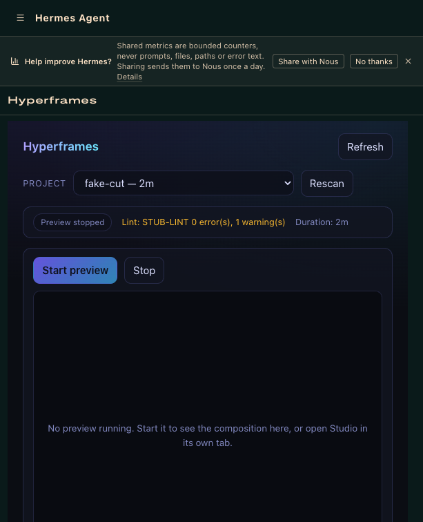
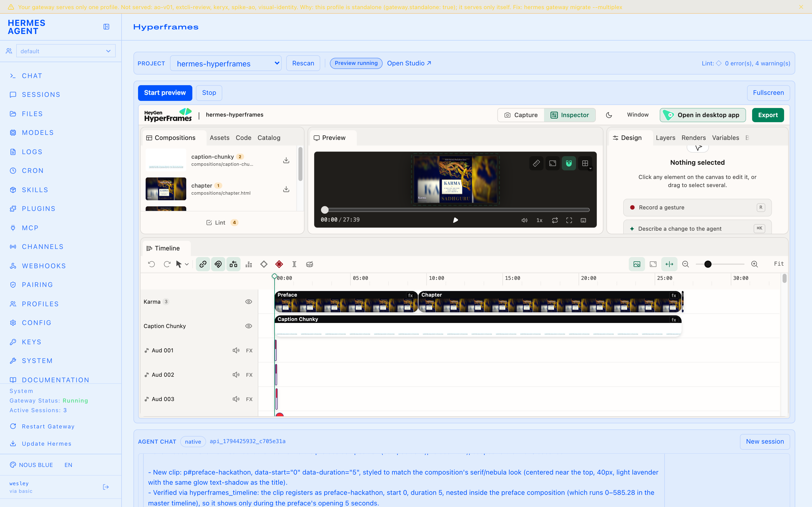
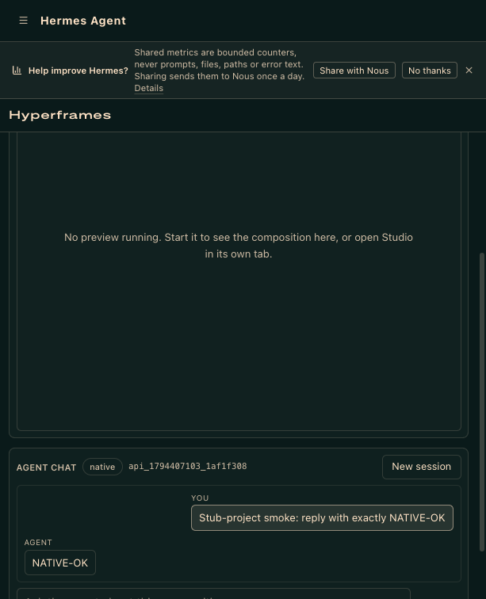

# hermes-hyperframes

A Hermes community plugin that drives [Hyperframes](https://github.com/ApacheOpenVideo/hyperframes) — Apache-2.0 HTML/JS video compositions — from Hermes: six `hyperframes_*` agent tools plus a dashboard tab with a managed Studio preview, frame snapshots, and an agent chat bound to the composition on screen.

The plugin wraps a **pinned local Hyperframes CLI** (no `npx`, no network fetch): bin resolution is the `bin` setting / `HERMES_HYPERFRAMES_BIN` > `PATH` > `<project>/node_modules/.bin/hyperframes`.

**Project confinement:** every `project_dir` must resolve under a configured projects root (`projects_roots` setting > `HERMES_HYPERFRAMES_PROJECTS_ROOTS` env > the workspace `<hermes home>/projects` > the tilde defaults). The project-local `node_modules/.bin/hyperframes` fallback runs the *project's own binary* on the host, so directories outside the roots — a cloned, untrusted repo, say — are refused outright.

**Minimal subprocess environment:** the CLI subprocess inherits only `PATH`, `HOME`, locale vars, `TMPDIR`, and their Windows equivalents (plus `$PWD` normalization) — never `os.environ`, so no provider key reaches the Node binary. Extra names can be opted in via the `env_passthrough` setting.

**Render output confinement:** `hyperframes_render` output must resolve *inside* the project dir — `..` segments, outside absolute paths and symlink escapes are refused, and an existing non-video file is never overwritten.

## What it adds

**Agent tools** (available in any session with the plugin enabled):

| Tool | Purpose |
| --- | --- |
| `hyperframes_lint` | Lint a composition, structured error/warning summary |
| `hyperframes_preview` | Start / status / stop the managed Hyperframes Studio preview |
| `hyperframes_preview_context` | Studio selection bridge — what the human has selected on the canvas |
| `hyperframes_timeline` | Read back the composition timeline (clips, spans, duration) |
| `hyperframes_snapshot` | Capture contact sheets / frames for visual verification |
| `hyperframes_render` | Render the composition to MP4 |

**Dashboard tab** (`/hyperframes`, after Skills): project switcher (scans your project roots), one-toolbar-row status (preview state, lint, duration), the Studio preview embedded live, and an agent chat. The tab consumes the dashboard's own theme variables, so it follows whatever theme is active.

## Agent chat: two lanes, native by default

The chat panel drives a **real Hermes gateway session** — the same conversation a terminal sees via `hermes chat --resume <session-id>`:

- **Native lane (default, zero config):** the plugin auto-derives the local gateway's `api_server` listener from `~/.hermes/gateway_state.json` and authenticates with `API_SERVER_KEY` read through Hermes's secret API (`agent.secret_scope.get_secret` — the profile secret scope the gateway itself installs, then the process env). Each message is one synchronous gateway turn carrying the current project path + preview state as context, so the session can act on the composition with its `hyperframes_*` tools.
- **CLI fallback:** only when no gateway credential resolves at all — one local `hermes chat -q` per message (slow).

Resolution order for the credential: plugin `api_server_key` setting > `HERMES_API_SERVER_KEY` env > `agent.secret_scope.get_secret("API_SERVER_KEY")`. The `.env` file is never parsed by the plugin itself. URL: plugin `api_server_url` setting > `HERMES_API_SERVER_URL` env > `gateway_state.json` listener_base (loopback `127.0.0.1:8642`).

## Heavy actions — disclosure

This plugin spawns and stops local processes and talks to the local gateway. Specifically:

- `hyperframes_preview` **starts and kills** the Hyperframes Studio preview process for the selected project.
- `hyperframes_render` **runs the pinned Hyperframes CLI** to encode MP4 output (inside the project dir only).
- The chat lane **creates sessions in your local Hermes gateway** (`POST /api/sessions`) and **may run `hermes chat -q` as a subprocess** in the fallback lane. Every message costs a real model call.
- The chat credential is read through Hermes's secret API (`API_SERVER_KEY` only) — never parsed out of `.env`, never logged or echoed.

Everything is loopback/local: the plugin talks to the local stack — your Hyperframes CLI, your gateway, your disk. No third-party network calls, no telemetry.

## Configuration (`config_schema`)

| Setting | Default | Purpose |
| --- | --- | --- |
| `projects_roots` | `["~/projects/personal", "~/projects/clients"]` | ALLOWLIST — the only dirs the tools and the tab may touch (the project-local bin runs on the host); the tab scans these roots (depth 1) for projects |
| `api_server_url` | `""` | Override for the gateway api_server base URL; empty auto-derives |
| `api_server_key` | `""` | Override for the gateway key; empty auto-derives through `agent.secret_scope.get_secret` |
| `bin` | `""` | Optional absolute CLI path, replaces the `HERMES_HYPERFRAMES_BIN` env lookup |
| `project` | `""` | Optional default project dir for the tools (must still sit under `projects_roots`) |
| `env_passthrough` | `[]` | Optional env var names the minimal CLI subprocess may additionally inherit |

## Requires

- A local [Hyperframes](https://www.npmjs.com/package/hyperframes) install (the CLI comes from your project's `node_modules`).
- Hermes >= 0.21 with the dashboard; the agent chat's native lane additionally wants the gateway `api_server` platform enabled.

## Install

```sh
hermes plugins install wesleymatosdev/hermes-hyperframes-plugin --ref <full-40-hex-sha> --enable
```

## Screenshots

Before/after the v0.3.0 de-clutter (nebula theme removed, tab follows the dashboard theme, snapshot gallery moved to agent tools):





## Tests

```sh
HERMES_SRC=~/.hermes/hermes-agent ~/.hermes/hermes-agent/.venv/bin/python -m unittest discover -s tests
```

The suite runs against a fake loopback gateway (`http.server` on port 0), a stub `hyperframes` bin, a stub `hermes` CLI, and a temp `HERMES_HOME` per test — no real composition project is ever touched. The auto-derivation suite (`tests/test_native_autoderive.py`) was proven RED against the pre-fix behavior before the native lane landed.

## License

MIT — see [LICENSE](LICENSE).
